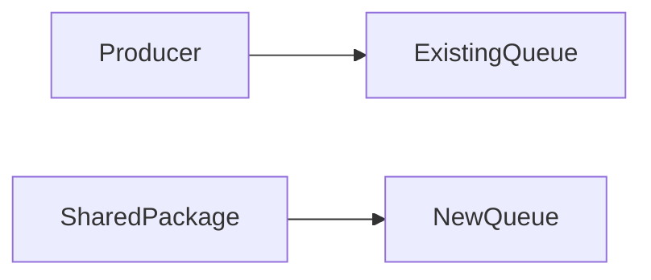

## Overview

The fixture stages a shared queue without changing the active production path.

## Findings

No findings found in the supplied diff.

## Architecture and schema

### Staged queue path

## Changed areas

- **Queue:** Adds a staged shared queue package.

## Coverage gaps

- Live deployment state was not inspected.

**Run and cost details**

- Provider: cheaperinference
- Model / effort: fixture/model / not explicitly set
- Reviewed SHA: 0123456789abcdef0123456789abcdef01234567
- Run: fixture-1
- Skills: review-coordinator, i-have-adhd, stop-slop
- Tokens: 100000 input, unknown cached input, unknown reasoning, 5000 output
- Model calls: 1
- Tool iterations: 3
- Estimated cost: $0.01325
